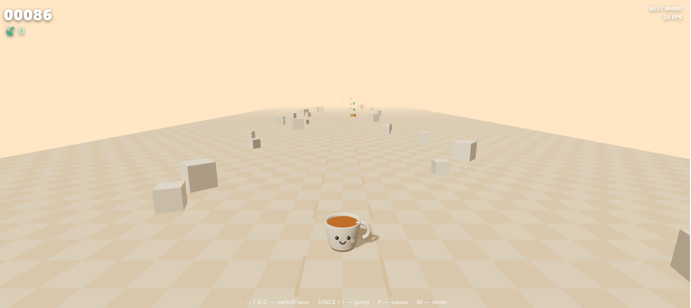
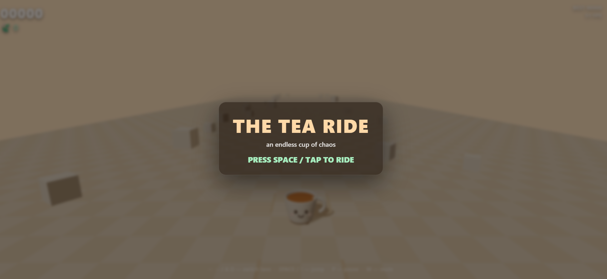
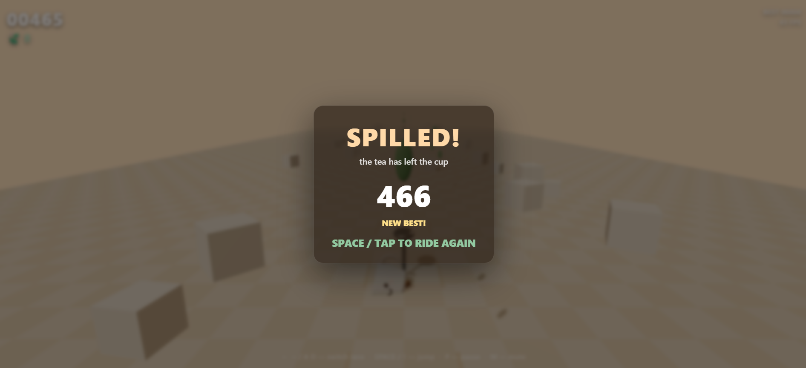

# 🍵 The Tea Ride — 3D Endless Runner

*An endless cup of chaos.* Guide a tiny, cheerful teacup as it sprints across a tabletop, dodging sugar cubes, biscuits and spoons while collecting tea leaves. Don't spill the tea!

Built with **Three.js** in a HTML file. No build step, no assets, no installs.

---

## 📸 Screenshots

| Menu | Gameplay | Game Over |
|:---:|:---:|:---:|
|  |  |  |

---

---
## gameplay
<video src="screenshots/gameplayRC.mp4" controls autoplay loop muted width="600"></video>
---

## ✨ Features

- **3-lane endless runner** with smooth lane switching and a lean animation
- **Double jump** with squash-and-stretch and landing dust
- **Cute teacup hero** with a face, handle, running legs and sloshing tea
- **Obstacles:** sugar cubes (single and wide), chocolate-chip biscuits, and tall spoons
- **Collectible tea leaves 🍃**, often arranged in arcs above obstacles
- **Progressive difficulty:** speed ramps up the further you run
- **Procedural sound effects** generated with the Web Audio API (no audio files)
- **Particle effects** for jumps, landings, leaf pickups and crashes
- **Screen shake** and a tip-over animation when you spill
- **Best score saved** locally in your browser
- **Works on desktop and mobile** with keyboard, touch and swipe controls
- Live **FPS counter** in the corner

---

## 🎮 Controls

### Keyboard

| Action | Keys |
|---|---|
| Switch lane | `←` `→` or `A` `D` |
| Jump (press again in the air to double jump) | `Space`, `↑`, `W` or `Enter` |
| Pause / resume | `P` |
| Mute / unmute | `M` |
| Restart | `R` |

### Touch

| Action | Gesture |
|---|---|
| Jump / start / restart | Tap |
| Switch lane | Swipe left or right |

---

## 🏆 Scoring

```
Score = distance travelled + (leaves collected × 10)
```

Your best score is stored in `localStorage` under the key `teaRide3d.best`.

---

## 🚀 Getting Started

### Option 1: Just open it
Double-click `index.html`. Because it imports Three.js from a CDN, you need an internet connection.

### Option 2: Run a local server (recommended)

```bash
# Python
python -m http.server 8000

# or Node
npx serve .
```

Then visit **http://localhost:8000**.

### Option 3: Host it
Drop `index.html` on GitHub Pages, Netlify, Vercel or any static host.

---

## 🧰 Tech Stack

- [Three.js](https://threejs.org/) `r160` (loaded via ES module import map from unpkg)
- Vanilla JavaScript (ES modules)
- HTML5 + CSS3 for the HUD and overlays
- Web Audio API for sound effects

---

## 📁 Project Structure

```
.
├── index.html        # The entire game (HTML, CSS, JS)
├── screenshots/      # Images used in this README
└── README.md
```

---

## 🛠️ Tweaking the Game

All main settings are constants at the top of the script:

| Constant | Purpose | Default |
|---|---|---|
| `BASE_SPEED` | Starting run speed | `20` |
| `MAX_SPEED` | Speed cap | `46` |
| `GRAVITY` | Fall strength | `42` |
| `JUMP_V` | Velocity of 1st / 2nd jump | `[13.2, 11.6]` |
| `MAX_JUMPS` | Number of jumps allowed | `2` |
| `LANES` | X position of each lane | `[-2.6, 0, 2.6]` |

Obstacle types and spawn weights live in `OBSTACLE_DEFS`.

---

## 🐛 Troubleshooting

- **Black or blank screen:** make sure you're online (Three.js loads from a CDN) and that your browser supports WebGL.
- **No sound:** browsers block audio until the first interaction. Press a key or tap once. Also check that you haven't muted with `M`.
- **Low FPS:** close other tabs, or lower the pixel ratio cap in the `renderer.setPixelRatio(...)` calls.

---

## 📄 License
This project is licensed under the [MIT License](LICENSE).

---

Made with ☕ and a lot of spilled tea.
